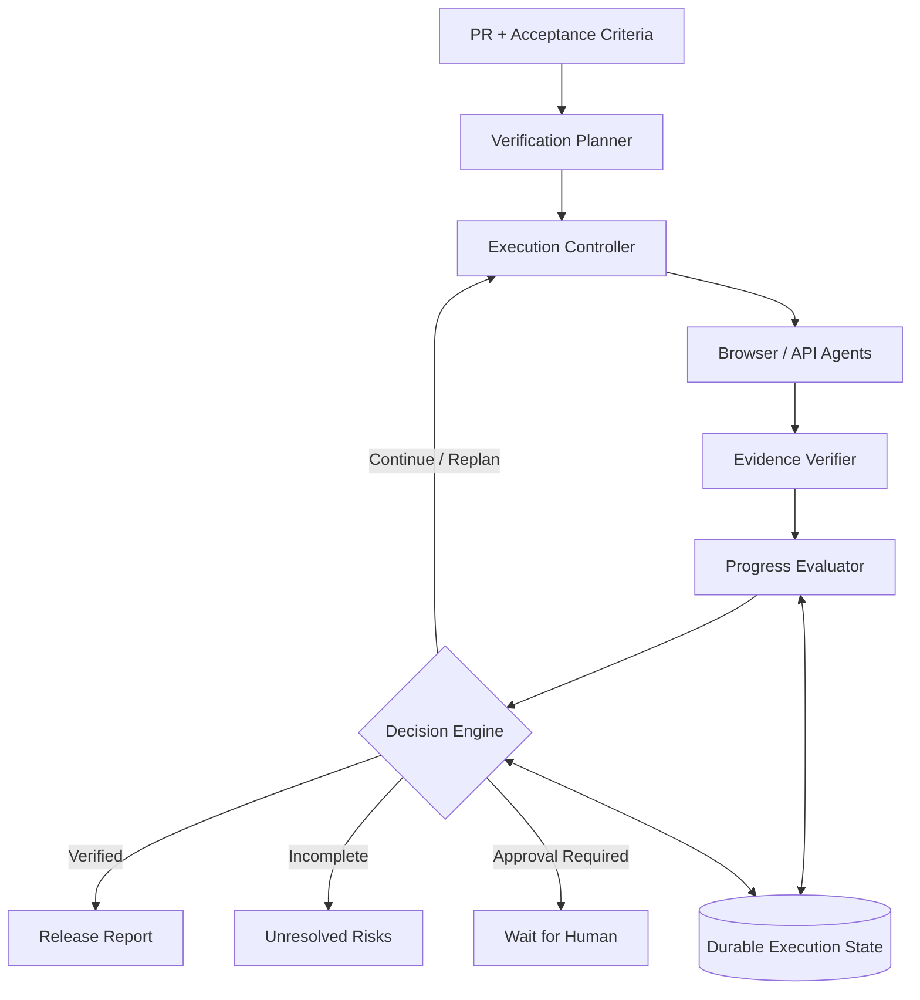

# ShipProof

### Know what actually works before you ship.

ShipProof is an AI-powered release verification system that investigates GitHub pull requests, maps feature requirements to executable checks, runs browser and API tests, and produces evidence-backed release-readiness reports.

**The idea is simple: passing CI doesn't necessarily mean a feature works as intended.**

A PR might pass every unit test while still breaking a user journey, missing a requirement, or introducing an unexpected regression.

ShipProof aims to close that gap.

---

## The Problem

AI coding tools have made generating software faster than ever. But verifying that a change actually satisfies its requirements is still a challenge.

Traditional tests are often predefined. AI agents can explore dynamically, but autonomous verification introduces its own problems:

- How do we know whether a requirement has genuinely been verified?
- How much testing is enough?
- What if the agent keeps repeating unproductive actions?
- What happens when verification is incomplete or uncertain?

ShipProof approaches these questions through **evidence-driven verification and progress-aware agent execution**.

## How ShipProof Works

```text
GitHub PR + Requirements + Staging URL
                  |
          Change Impact Analysis
                  |
          Verification Planning
                  |
       Progress-Aware Controller
                  |
           Browser / API Tests
                  |
          Evidence Verification
                  |
          Release Readiness Report
```

### 1. Understand the change

Analyze the PR to identify changed files, affected components, and relevant feature requirements.

### 2. Plan verification

Translate requirements into targeted browser and API checks using deterministic rules and optional LLM-assisted planning.

### 3. Execute and collect evidence

Run checks against an authorized staging environment and collect observations, assertion results, and screenshots.

### 4. Evaluate progress

Track requirement coverage, new evidence, repeated actions, and execution budgets.

### 5. Report the outcome

Generate a release-readiness report explaining what passed, what failed, and what remains unverified.

---

## The Core Architecture: Progress-Aware Execution

One of ShipProof's central design decisions is separating **agent reasoning from execution control**.

The agent proposes actions. An independent controller decides whether execution should continue.



Instead of relying only on fixed iteration limits, the controller considers:

- **Completion:** Have the required checks been independently verified?
- **Progress:** Are recent actions producing useful new evidence?
- **Budget:** How much execution time and cost remain?
- **Risk:** Does the next action require authorization or human approval?

The controller supports continuing, replanning, finishing verification, stopping incomplete, and waiting for approval.

Importantly, **finishing verification is not the same as approving a release**.

## Evidence Over Confidence

ShipProof does not treat an LLM's confidence as proof that a feature works.

Verification outcomes are grounded in executed checks and observable evidence.

| Status | Meaning |
|---|---|
| PASS | Requirement satisfied by executed assertions |
| FAIL | Executed assertions found a violation |
| UNKNOWN | Insufficient evidence or incomplete verification |

The resulting release recommendation can be **READY**, **BLOCKED**, or **NEEDS_REVIEW**.

A READY recommendation applies only to the configured verification scope-not a guarantee that the software contains no defects.

## Tech Stack

| Layer | Technology |
|---|---|
| Backend | Python, FastAPI |
| Frontend | React, TypeScript, Tailwind CSS |
| Agent reasoning | OpenRouter |
| Browser verification | Playwright |
| API verification | HTTPX |
| Persistence | PostgreSQL |
| Infrastructure | Docker Compose |

OpenRouter provides model-assisted analysis and verification planning, while deterministic verifiers remain responsible for test outcomes.

## Getting Started

### Prerequisites

- Docker and Docker Compose
- An OpenRouter API key for LLM-assisted features (optional for the deterministic demo)

### Run locally

```bash
git clone <YOUR_REPOSITORY_URL>
cd shipproof

cp .env.example .env
docker compose up --build
```

Configure your OpenRouter credentials in `.env` if enabling model-assisted features:

```env
OPENROUTER_API_KEY=your_api_key
OPENROUTER_MODEL=your_selected_model
```

Use the service URLs defined by Docker Compose to open the application.

### Try ShipProof

1. Open the application.
2. Select a bundled demo scenario or provide a supported public GitHub PR.
3. Add feature requirements and an authorized staging URL.
4. Review the generated verification plan.
5. Start verification and inspect the execution timeline.
6. Review the evidence-backed release report.

The deterministic demo is designed to work without a paid LLM API.

## Execution Policy Experiments

ShipProof also explores three different strategies for controlling autonomous verification:

| Policy | Strategy |
|---|---|
| Fixed limit | Stop on completion or a predefined hard limit |
| Stagnation-aware | Detect repeated non-progress and trigger replanning |
| Progress-aware | Consider evidence coverage, stagnation, and remaining resources |

The goal is to investigate whether smarter execution control reduces unnecessary work **without compromising verification coverage**.

No performance improvement should be assumed without reproducible experiments.

## Design Principles

**Verification before confidence.** Assertions and observable evidence determine outcomes.

**Separation of concerns.** Planning, execution, verification, and control remain independent components.

**Explicit uncertainty.** Missing evidence never silently becomes a PASS.

**Durable execution.** Run state, decisions, and budgets are persisted for reliability and inspection.

**Safety by design.** Verification targets authorized staging environments. Consequential actions require appropriate approval.

**Measure, don't assume.** Architectural improvements should be evaluated against simpler baselines.

## Current Scope and Limitations

ShipProof is intended for scoped release verification, not exhaustive software correctness.

Its effectiveness depends on requirement quality, available staging environments, supported browser/API checks, and the evidence collected.

LLM-generated verification plans may be incomplete or incorrect. Browser checks can be flaky, and untested functionality may still contain defects.

It is not a replacement for code review, security testing, or a complete production release process.

## Motivation

ShipProof began with a broader architectural question:

**How should an AI agent know when to stop?**

Rather than treating that as an isolated research experiment, ShipProof applies the question to a practical engineering workflow: verifying software before release.

The larger idea is to build AI systems that don't just execute more actions, but make better decisions about **what needs verification, what constitutes progress, and when enough evidence has been collected**.

---

**Built as an exploration of agentic systems architecture, reliability engineering, and evidence-driven software verification.**